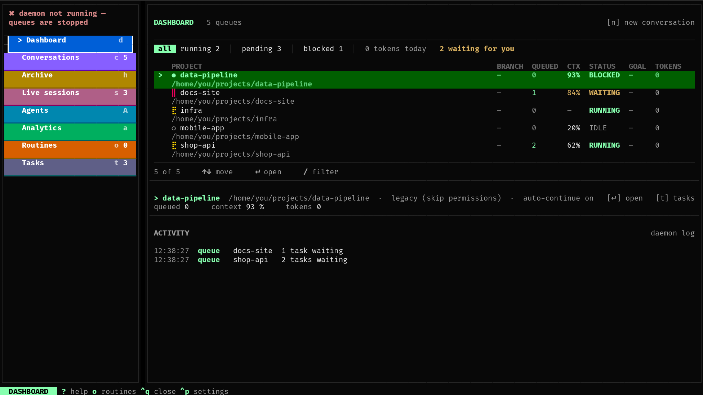
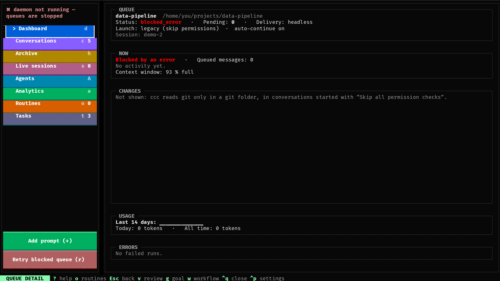

# Přehled

Přehled (`d`) ukazuje všechny konverzace a to, co zrovna dělají. Slouží
jen k dívání — s konverzací pracuješ v [Konverzacích](conversations.md).

## Záhlaví a filtr

Panel začíná nápisem **PŘEHLED** a počtem konverzací; vpravo
`[n] nová konverzace` (kliknutím nebo `n` ji otevřeš).

Řádek pod ním filtruje tabulku: **vše** · **běží** (Claude na nich
pracuje) · **čeká** (úkoly čekající ve frontách) · **zablokováno**
(zastavené chybou). Klikni na jeden, nebo je projdi klávesou `/`; vybraný
je zelený. Vedle nich: dnes spotřebované tokeny a žlutě, kolik konverzací
**čeká na tebe** (schválení nástroje, chyba, limit, dokončená odpověď, na
kterou ses ještě nepodíval(a) — stejné, na které skáče klávesa Alt+N).

## Tabulka

Jeden řádek na konverzaci (archivované jsou v [Archivu](archive.md));
vybraná je zelená a má před sebou `>`:

| Sloupec | |
|---|---|
| Projekt | název konverzace se značkou (viz níže) a pod ním složka projektu, ve které Claude pracuje (*Cesta*), zkrácená zepředu — poslední složka je vidět vždy |
| Větev | větev, neuložené řádky (`+12−3`) a commity před `↑` / za `↓` základní větví; `–` mimo git a u konverzace, kde Claude nesmí sám spouštět příkazy (ccc spouští git jen tam, viz [Git](git.md)) |
| Ve frontě | úkoly čekající v její [frontě](tasks.md) |
| Kontext | jak plný je její kontext (žlutě od 80 %, červeně od 90 %) |
| Stav | co dělá — viz tabulka níže |
| Cíl | její poslední [smyčka k cíli](goal.md): `◎ 3/5` (kolo / kol) za běhu, den po skončení `✅ splněno 3/5` / `⛔ zaseknuto 4/5` / `⛔ došla kola 5/5` / `✖ selhalo` / `■ zastaveno`; jinak `–` |
| Tokeny | tokeny, které dnes spotřebovala |

Pod tabulkou: kolik řádků je vidět z kolika a klávesy.

**Vybraná konverzace** je popsaná pod tabulkou: její složka, volby Claude
Code a automatické pokračování; kolik úkolů čeká, jak plný je kontext,
dnešní tokeny, větev; vpravo její nejnovější commit (ve složkách s gitem,
kde Claude smí spouštět příkazy) a klávesy `[↵] otevřít` a `[t] úkoly`.

**Aktivita** dole je to, co se v konverzacích stalo naposledy, od
nejnovějšího: `task` (dokončený úkol i s commitem), `queue` (čekající
úkoly), `limit` (limit spotřeby), `approve` (nástroj čeká na tebe),
`error` a `review`.

**Které sloupce** (*Cesta* je složka pod názvem) — Nastavení → Přehled: jedna volba pro terminálovou
verzi ccc (aplikace pro Android má vlastní). Název je vidět vždy;
výchozí je ukázat i všechno ostatní.

**Značky** před názvem — stejné jako v seznamu Konverzací:

| Značka | Význam |
|---|---|
| zlatá `⣾⣷⣯⣟⡿⢿⣻⣽` (otáčí se) | Claude pracuje |
| `‖` | čeká na obnovení limitu využití, nebo je pozastavená |
| červená `●` | zastavila se chybou — potřebuje tě |
| modrá `●` | Claude čeká, až [schválíš nástroj](approvals.md) |
| zelená `●` | hotovo — nová odpověď, kterou jsi ještě neviděl(a) |
| `○` | nečinná a poslední odpověď jsi už viděl(a) |

V seznamu Konverzací znamená `·3` za názvem tři úkoly ve frontě.

**Stav:**

| Stav | |
|---|---|
| `NEČINNÁ` | nemá co dělat; další úkol začne, jakmile nějaký přidáš |
| `BĚŽÍ` | Claude pracuje na úkolu |
| `ČEKÁ` | čeká na obnovení limitu využití; pak sama pokračuje |
| `LIMIT` | zastavila se na limitu využití s vypnutým automatickým pokračováním — čeká na tebe |
| `ZABLOKOVÁNO` | zastavila se chybou — čeká na tebe |

Co s posledními dvěma: [Limity využití a zablokované fronty](limits.md).

## Detail fronty

`Enter` na řádku otevře detail konverzace:

- její nastavení (složka, volby Claude Code, automatické pokračování)
  a u konverzace se [vzdáleným ovládáním](remote-control.md) odkaz, jak
  ji otevřít v telefonu;
- **Teď**: jestli Claude pracuje, čeká na tvé schválení nebo na limit,
  kolik zpráv je ve frontě a co se v konverzaci stalo naposledy;
- **Změny**: větev složky a soubory s necommitnutými změnami, s počtem
  přidaných a odebraných řádků (jen ve složce s gitem a v konverzacích
  spuštěných s *Přeskočit všechny kontroly oprávnění*, protože git ccc
  spouští jen tam);
- **Spotřeba**: tokeny za posledních 14 dní a použité modely;
- **Chyby**: poslední selhané běhy a co konverzaci teď blokuje.
  Stránka se obnovuje sama;
- `+` přidá konverzaci úkol, `r` ji znovu rozběhne, když je zablokovaná
  nebo pozastavená na limitu. `Esc` vrací zpět.

## Prázdný Přehled

Před první konverzací ukazuje Přehled místo tabulky **Začínáme** — tři
kroky na začátek. Stiskni `n`.
