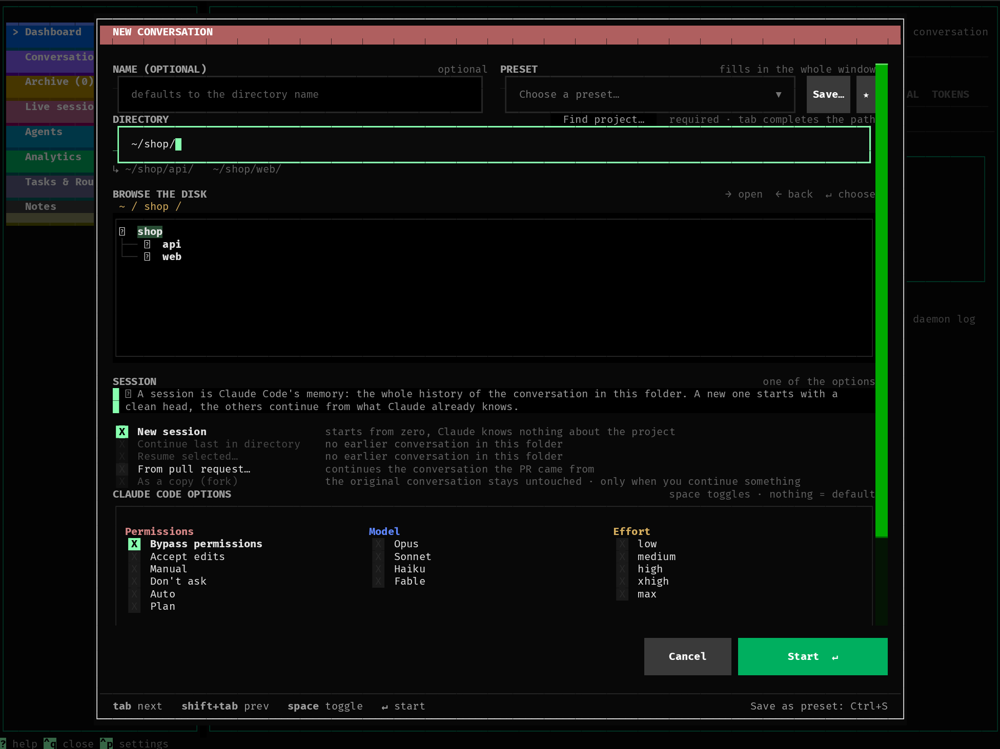

# Zahájení konverzace

Kdekoli stiskni `n` (nebo zelené tlačítko **Nová konverzace**
v Konverzacích, případně `[n] nová konverzace` na Přehledu). Odshora:
název a předvolba, složka (s nedávnými složkami a stromem disků vedle),
relace, všechny volby Claude Code a vlastní přepínače ccc; dole **Spustit**.

- **Tab** v poli složky doplní cestu (nabídka je pod polem); **Enter** složku
  jen potvrdí a přejde dál — nikdy nespustí. **Spustit** je tlačítko,
  `Ctrl+Enter` odkudkoli, nebo `Enter` v názvu.
- Všechno je vidět najednou; okno se posouvá. V úzkém okně (telefon) jsou
  sloupce pod sebou.
- `Ctrl+S` uloží volbu jako předvolbu (nebo **Uložit…** vedle Předvolby).

## Složka

Složka projektu, ve které bude Claude pracovat. Napiš cestu (**Tab** ji
doplní), vyber některou z **nedávných** (↑↓, Enter), nebo projdi **strom
disků**: zahrnuje všechny disky, → složku otevře, ← zavře (nahoře jde o úroveň
výš, až do `/`), Enter ji zvolí. Skryté složky (název začíná tečkou) strom ani
doplňování neukazují, dokud tečku nenapíšeš sám; systémové složky (`/proc`,
`/sys`…) se neukazují nikdy. Složka, která už neexistuje, se z nedávných vynechá.

**Najít projekt…** hledá podle části názvu složky s `.git` v domovské složce
a na dalších discích (`/mnt`, `/media`). Běží jen po dobu, kdy je jeho okno
otevřené, s omezenou hloubkou a časem, a výsledky přibývají průběžně; Enter na
některém složku vyplní.

## Relace

*Relace je paměť Claude Code: celá historie rozhovoru v této složce.* Nová
začne s čistou hlavou, ostatní navážou na to, co už Claude ví. **Pokračovat**
a **Obnovit** jsou ve složce bez dřívějšího rozhovoru vypnuté i s důvodem
vedle; **Jako kopie** jen když je z čeho kopírovat; **Vlastní git worktree**
jen v git repozitáři.

## Volby

Stejné přepínače jako na příkazové řádce `claude`. Skupiny označené
*jedna* dovolí jen jednu volbu.

| Skupina | Volby |
|---|---|
| Relace (*jedna*) | **Nová relace** · **Pokračovat v poslední ve složce** · **Obnovit vybranou…** (vybereš některou z dřívějších relací Claude Code v této složce) · **Z pull requestu…** |
| | **Jako kopie (fork)** — s Pokračovat / Obnovit / Z PR: nová konverzace, která z té původní vychází; původní zůstane, jak byla |
| Oprávnění (*jedna*) | **Bypass permissions** — Claude dělá všechno bez ptaní · **Accept edits** — úpravy souborů ano, ostatní nástroje se ptají · **Manual** — ptá se každý nástroj, i úpravy · **Don't ask** — co ještě není povolené, se odmítne, nic se neptá · **Auto** — Claude Code sám rozhoduje, co je bezpečné · **Plan** — Claude planuje |
| Model (*jedna*) | Opus · Sonnet · Haiku · Fable |
| Úsilí (*jedna*) | low · medium · high · xhigh · max |
| MCP servery | **Jen vybrané MCP servery (méně tokenů)** — viz [MCP servery](#mcp-servery) |
| Ostatní | Při přetížení přejít na Sonnet · Claude v Chromu · Bezpečný režim |
| | **Vlastní git worktree** — samostatná pracovní kopie a větev pro tuto konverzaci (`.claude/worktrees/<název>`, větev `worktree-<název>`), aby mohla pracovat vedle ostatních ve stejném repozitáři; jen s novou relací nebo z pull requestu a s *Bypass permissions* (ccc spouští git jen tam). Viz [Git](git.md#více-konverzací-v-jedné-složce) |

Pod nimi:

- **Automaticky pokračovat po limitu využití** (výchozí zapnuto) — když
  Claude narazí na tvůj limit využití, konverzace počká na obnovení
  a sama pokračuje. Vypnuto: zastaví se a čeká na tebe. Viz
  [Limity využití](limits.md).
- **Vzdálené ovládání (telefon / claude.ai)** — v konverzaci můžeš
  pokračovat i z mobilní aplikace Claude. Viz
  [Vzdálené ovládání](remote-control.md).

Nic nezaškrtnuto znamená výchozí nastavení Claude Code.

## MCP servery

Claude Code ve výchozím stavu načte každý MCP server, který najde — tvoje
z `~/.claude.json`, `.mcp.json` ve složce i konektory z claude.ai (Gmail,
Vercel…) — a definice všech jejich nástrojů dává do kontextu každého tahu.
Při pár velkých serverech jsou to stovky nástrojů a spousta tokenů, které
platíš s každou zprávou, ať je konverzace potřebuje, nebo ne. (Jedno
měření: 543 nástrojů bez výběru, 24 bez serverů.)

Zaškrtni **Jen vybrané MCP servery** a pod tím se objeví servery nastavené
pro zvolenou složku; zaškrtni ty, které smí konverzace používat. Nic
nezaškrtnuto znamená žádné. Vlastní server ccc (schvalování) je zapnutý
tam, kde je potřeba. Výběr platí pro celou konverzaci,
pamatuje se na příště a ukládá se do předvoleb.

- Konektory z claude.ai vybírat nejde: s touto volbou jsou všechny vypnuté.
- Server z `.mcp.json` ve složce se nabídne až poté, co jsi ho pro tu
  složku schválil v Claude Code (zeptá se při prvním použití); repozitář
  tak nemůže spustit příkaz jen tím, že server definuje.
- Server, který jsi mezitím z konfigurace odstranil, se přeskočí.
- ccc ukládá jen názvy, nikdy nastavení serverů (mohou obsahovat tokeny);
  nastavení se čte při startu Claude Code.

## Pluginy

Pluginy Claude Code jsou zapnuté globálně, pro všechny konverzace. Mění,
jak se konverzace chová: hooky přidávají kontext, skills řídí model (plugin
ho může nechat nejdřív vyvolat skill, než odpoví), pluginy s sebou nesou
vlastní MCP servery a každý ukrojí část kontextového okna.

Zaškrtni **Jen vybrané pluginy** a pod tím se objeví nainstalované pluginy,
ty, které máš teď zapnuté, jsou už zaškrtnuté; odškrtni, bez čeho má
konverzace běžet. Nic nezaškrtnuto znamená žádný plugin. Bez této volby
konverzace zdědí tvé pluginy jako dosud. Výběr platí pro celou konverzaci,
pamatuje se na příště a ukládá se do předvoleb. Detail konverzace ukazuje,
s jakými pluginy běží.

- Pluginy se přepínají jen pro tuto konverzaci; tvůj `settings.json` se
  nemění.
- Plugin, který jsi mezitím odinstaloval, se přeskočí.
- Instalace a odebírání pluginů zůstává v Claude Code (`/plugin`).

## Agent

Zaškrtni **Celá konverzace jako jeden agent** a pod volbou se objeví
[agenti](agents.md), které Claude Code pro složku najde; vyber jednoho.
Claude Code pak naběhne jako ten agent (`claude --agent <jméno>`) a jeho
instrukce, nástroje i model platí pro celou konverzaci. Hodí se na *roli*
(„revizor“, „překladatel“), ne na pomocníka, kterého má Claude zavolat čas
od času: toho volá sám i bez této volby.

- Prompt agenta **nahrazuje** vlastní instrukce Claude Code. Vyber agenta
  napsaného pro tohle: krátký prompt pomocníka dělá špatného hlavního
  asistenta.
- Platí pro celou konverzaci, pamatuje se na příště a ukládá do předvoleb;
  detail konverzace ho ukazuje.
- Agent, který mezitím zmizel, je označen „nenalezeno zde“; ccc s ním
  nespustí.

## Předvolby

**Uložit jako předvolbu** uloží aktuální volby (ne název ani složku) pod
názvem; **Vyber předvolbu…** jí okno vyplní. Předvolby mažeš
v [Nastavení](settings.md). **★** vedle Uložit… udělá zobrazenou předvolbu
**výchozí**: okno se s ní otevře. Dalším stisknutím žádná výchozí není
a okno se otevře s tvou poslední volbou, jako dřív.

## Po Spustit

Jsi v [Konverzacích](conversations.md) a vedle ccc je otevřené Claude
Code. Obnovení relace, která už v ccc konverzaci má, jen přepne na tu
konverzaci — pokud nezaškrtneš *Jako kopie (fork)*.
