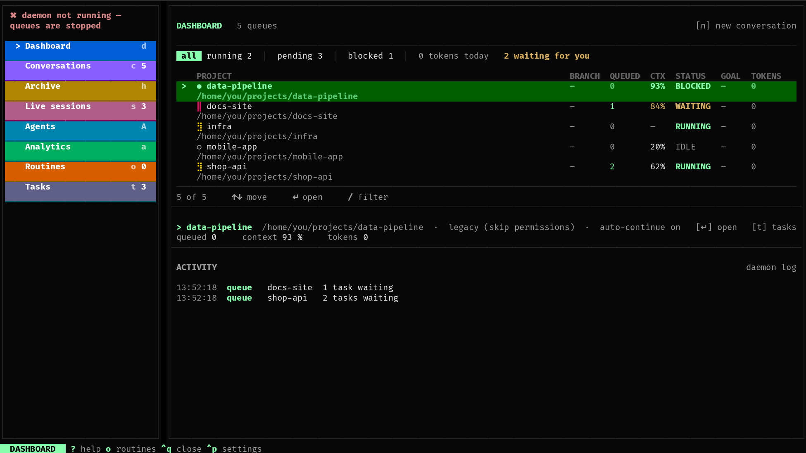
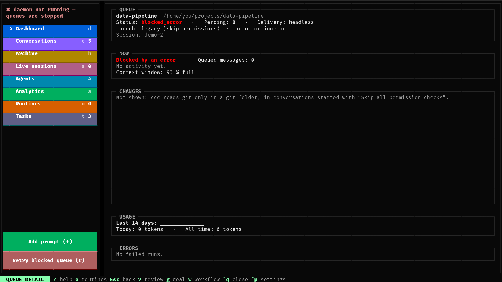

# Dashboard

The Dashboard (`d`) is the overview: every conversation with what it's
doing right now. It's only for looking — you work with a conversation in
[Conversations](conversations.md).

## Overview

The top line counts all conversations: how many Claude is working on
(**running**), how many tasks wait in their queues (**pending**), how
many stopped on an error (**blocked**, red), how many **wait for you**
(yellow: a tool approval, an error, a usage limit, a finished reply you
haven't looked at — the same ones the Alt+N key jumps to), and how many
tokens they used today.

## The table

One row per conversation (archived ones are in the [Archive](archive.md)):

| Column | |
|---|---|
| Project | the conversation's name, with its marker (see below) |
| Status | what it's doing — see the table below |
| Goal | its latest [goal loop](goal.md): `◎ 3/5` (round / rounds) while it runs, `✅ met 3/5` / `⛔ stuck 4/5` / `⛔ out of rounds 5/5` / `✖ failed` / `■ stopped` for a day after it ended; `–` otherwise |
| Pending | tasks waiting in its [queue](tasks.md) |
| Today's tokens | tokens it used today |
| Git | the branch, uncommitted lines (`+12−3`) and commits ahead `↑` / behind `↓` its base branch; `–` outside git, and for a conversation where Claude may not run commands itself (ccc runs git only there, see [Git](git.md)) |
| Path | the project folder Claude works in, shortened from the front — the last folder is always shown |

**Which columns** — Settings → Dashboard: one choice for the terminal
version of ccc (the Android app has its own). The name is always shown;
by default everything else is too.

**Markers** in front of the name — the same in the Conversations list:

| Marker | Meaning |
|---|---|
| gold `⣾⣷⣯⣟⡿⢿⣻⣽` (turning) | Claude is working |
| `‖` | waiting for a usage-limit reset, or paused |
| red `●` | stopped on an error — needs you |
| blue `●` | Claude is waiting for you to [approve a tool call](approvals.md) |
| green `●` | finished — a new reply you haven't looked at yet |
| `○` | idle, and you have already looked at its last reply |

In the Conversations list `·3` after the name means three tasks queued.

**Status:**

| Status | |
|---|---|
| `idle` | nothing to do; the next task starts as soon as you add one |
| `running` | Claude is working on a task |
| `waiting_retry` | waiting for a usage limit to reset; then it carries on by itself |
| `paused_limit` | stopped at a usage limit with auto-continue off — waits for you |
| `blocked_error` | stopped on an error — waits for you |

What to do with the last two: [Usage limits & blocked queues](limits.md).

## Queue detail

`Enter` on a row opens the conversation's detail:

- its settings (folder, Claude Code options, auto-continue) and, for a
  [remote-control](remote-control.md) conversation, the link to open it
  on your phone;
- **Now**: whether Claude works, waits for your approval or for a usage
  limit, how many messages are queued and the last thing that happened
  in the conversation;
- **Changes**: the folder's branch and the files with uncommitted
  changes, with the lines added and removed (only in a git folder and in
  conversations started with *Skip all permission checks*, as ccc runs
  git only there);
- **Usage**: the tokens of the last 14 days and the models used;
- **Errors**: the latest runs that failed, and what blocks the
  conversation now. The page refreshes by itself;
- `+` adds a task to this conversation, `r` gets it going again when it's
  blocked or paused at a limit. `Esc` goes back.

## An empty Dashboard

Before your first conversation the Dashboard shows **Getting started**
instead — three steps to begin. Press `n`.
