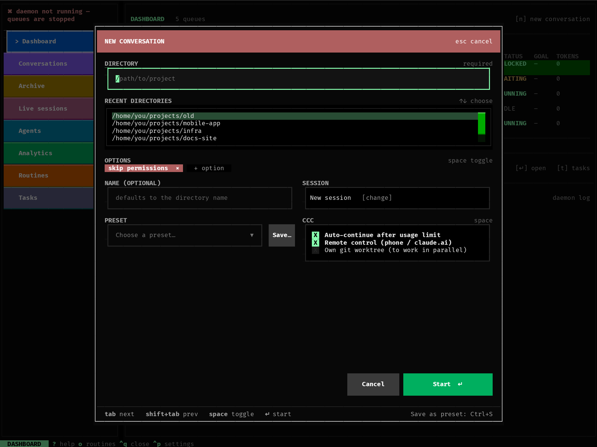

# Starting a conversation

Press `n` anywhere (or the green **New conversation** button in
Conversations, or `[n] new conversation` on the Dashboard). From the top:
the folder, the recent folders, the chosen options as coloured chips,
then name, session, preset and ccc's own switches; **Start** at the bottom
(or `Enter` in the folder or name field).

- A **chip** shows a chosen option (red: permissions, blue: model,
  yellow: effort, grey: the rest); a click on it drops the option.
- **+ option** opens every option below (in the groups of the table
  below) together with the folder tree to browse; the **Session** field
  opens them too, on the session's choice.
- `Ctrl+S` saves the choice as a preset (or **Save…** next to Preset).

## Directory

The project folder Claude will work in: pick one of the recent folders
(↑↓, Enter), type a path, or browse the folder tree (under **+ option**).

## Options

The same switches as on the `claude` command line. Groups marked *one*
allow only one choice.

| Group | Options |
|---|---|
| Session (*one*) | **New session** · **Continue last in directory** · **Resume selected…** (pick one of the folder's past Claude Code sessions) · **From pull request…** |
| | **As a copy (fork)** — with Continue / Resume / From PR: a new conversation that starts from that one, the original stays as it was |
| Permissions (*one*) | **Bypass permissions** — Claude does everything without asking · **Accept edits** — file edits yes, other tools ask · **Manual** — every tool asks, even edits · **Don't ask** — whatever isn't already allowed is refused, nothing asks · **Auto** — Claude Code decides itself which actions are safe · **Plan** — Claude only plans |
| Model (*one*) | Opus · Sonnet · Haiku · Fable |
| Effort (*one*) | low · medium · high · xhigh · max |
| MCP servers | **Only selected MCP servers (fewer tokens)** — see [MCP servers](#mcp-servers) |
| Other | Fallback to Sonnet when overloaded · Claude in Chrome · Safe mode |
| | **Own git worktree** — a separate checkout and branch for this conversation (`.claude/worktrees/<name>`, branch `worktree-<name>`), so it can work side by side with others in the same repository; only with a new session or one from a pull request, and with *Bypass permissions* (ccc runs git only there). See [Git](git.md#several-conversations-in-one-folder) |

Below them:

- **Auto-continue after usage limit** (on by default) — when Claude hits
  your usage limit, the conversation waits for the reset and carries on by
  itself. Off: it stops and waits for you. See
  [Usage limits](limits.md).
- **Remote control (phone / claude.ai)** — you can also continue the
  conversation from the Claude mobile app. See
  [Remote control](remote-control.md).

Nothing ticked means Claude Code's own defaults.

## MCP servers

By default Claude Code loads every MCP server it finds — yours from
`~/.claude.json`, the folder's `.mcp.json` and the claude.ai connectors
(Gmail, Vercel…) — and puts all their tool definitions into the context of
every turn. With a few large servers that is hundreds of tools and a lot of
tokens you pay for with every message, whether the conversation needs them
or not. (One test: 543 tools without a choice, 24 with none.)

Tick **Only selected MCP servers** and the servers configured for the chosen
folder appear below it; tick the ones this conversation may use. Nothing
ticked means none. ccc's own server (approvals) is on
where it is needed. The choice holds for the whole conversation, is remembered
for next time and saved in presets.

- claude.ai connectors can't be picked: with this option they are all off.
- A server from the folder's `.mcp.json` appears only after you've approved
  it for that folder in Claude Code (it asks the first time); a repository
  can't get a command run just by defining a server.
- A server that has since been removed from your configuration is skipped.
- ccc stores only the names, never the server settings (they can hold
  tokens); the settings are read when Claude Code starts.

## Plugins

Claude Code plugins are switched on globally, for every conversation. They
change how a conversation behaves: hooks add context, skills steer the
model (a plugin can make it start with a skill before it answers), plugins
bring their own MCP servers and each one takes part of the context window.

Tick **Only selected plugins** and the installed plugins appear below it,
those you have on now already ticked; untick what this conversation should
run without. Nothing ticked means no plugin at all. Without the option the
conversation inherits your plugins as before. The choice holds for the whole
conversation, is remembered for next time and saved in presets. The
conversation's detail shows which plugins it runs with.

- It switches plugins for this conversation only; your `settings.json`
  stays untouched.
- A plugin that has since been uninstalled is skipped.
- Installing or removing plugins stays in Claude Code (`/plugin`).

## Agent

Tick **Whole conversation as one agent** and the [agents](agents.md) Claude
Code finds for the folder appear below it; tick one. Claude Code then starts
as that agent (`claude --agent <name>`) and keeps its instructions, tools and
model for the whole conversation. Use it for a *role* ("reviewer",
"translator"), not for a helper Claude should call now and then: those
Claude calls by itself without this option.

- The agent's prompt **replaces** Claude Code's own instructions. Pick one
  written for this: a short helper prompt makes a poor main assistant.
- It holds for the whole conversation, is remembered for next time and
  saved in presets; the conversation's detail shows it.
- An agent that has since been deleted is marked "not found here"; ccc
  won't start with it.

## Presets

The window remembers your last choice. If you use a few combinations
often, **Save as preset** stores the current one under a name; **Choose a
preset…** fills the window with it. Delete presets in
[Settings](settings.md).

## After Start

You're in [Conversations](conversations.md) with Claude Code open beside
ccc. Resuming a session that already has a conversation in ccc just
switches to that conversation — unless you tick *As a copy (fork)*.
